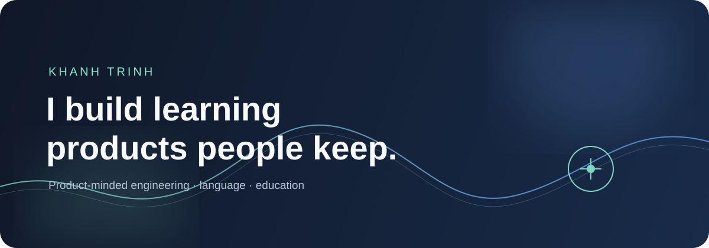

<div align="center">



<br />

[](https://lissenne.com)
[](https://www.djangoproject.com/)
[](https://react.dev/)
[](https://www.typescriptlang.org/)


</div>

## The short version

I build products at the intersection of **learning, language, and thoughtful software**.

I care about the parts that make a product last: a clear domain model, content that earns trust, interfaces that feel obvious, and operations that do not surprise the people running them.

## Selected work

### [Lissenne](https://lissenne.com) — language practice, grounded in real audio

Lissenne turns authentic audio into focused dictation and language-practice loops. It combines multilingual content, interactive React players, flashcards, and deliberate repetition in one Django product.

**Product**

Dictation · listening · flashcards · learning loops

**System**

Django 6 · React/TypeScript · PostgreSQL · Celery · Docker

### [Talyxion](https://github.com/khanhtrinh2003/Talyxion) — copy trading without custody

Talyxion is a quant-fintech platform for alpha research, copy trading, and a non-custodial DEX desk. Users can connect their own venue account or wallet, follow trading strategies, and keep control of their assets while the platform coordinates the workflow.

**Product**

Copy trading · alpha research · non-custodial DEX desk

**Focus**

Wallet ownership · trading workflows · risk controls

## How I work

```text
Understand the real problem
        ↓
Model the domain clearly
        ↓
Build the smallest useful loop
        ↓
Make it feel calm and obvious
        ↓
Keep it reliable in production
```

## Currently exploring

- Better practice loops for pronunciation, listening, and active recall
- Content tooling that preserves editorial quality at scale
- Local-first experiences that remain useful under imperfect connectivity
- Local-first experiences for imperfect connectivity

<div align="center">

**Build things that earn their place in someone's day.**

<a href="https://lissenne.com">Live product</a> · <a href="https://github.com/khanhtrinh2003/Talyxion">Talyxion on GitHub</a>

</div>

<div align="center">

### Build things that earn their place in someone's day.

</div>
